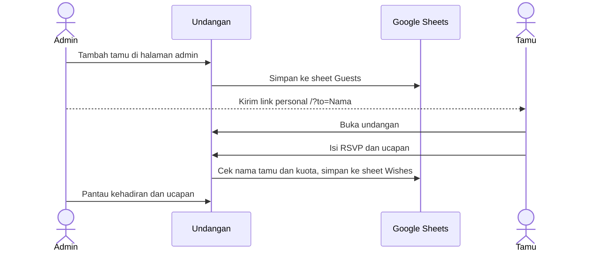

# Wedding Invitation

Undangan pernikahan digital Fedy & Suci: sapaan personal untuk setiap tamu, musik latar, hitung mundur, galeri foto, RSVP dan ucapan, serta amplop digital. Daftar tamu dan ucapan dikelola lewat halaman admin rahasia dengan Google Sheets sebagai penyimpanan.


**[Buka undangan](https://wedding-invitation-fedy-suci.vercel.app)** — undangan asli yang sedang dipakai, di-hosting di Vercel. Tambahkan `?to=Nama` di akhir alamat untuk melihat sapaan personal.


## Daftar Isi

- [Wedding Invitation](#wedding-invitation)
  - [Daftar Isi](#daftar-isi)
  - [Demo](#demo)
  - [Fitur](#fitur)
  - [Alur Undangan](#alur-undangan)
  - [Tech Stack](#tech-stack)
  - [Memulai](#memulai)
    - [Prasyarat](#prasyarat)
    - [Instalasi](#instalasi)
  - [Konfigurasi](#konfigurasi)
  - [Perintah](#perintah)
  - [Struktur Proyek](#struktur-proyek)
  - [Halaman Admin](#halaman-admin)
  - [Dokumentasi](#dokumentasi)
  - [Kontribusi](#kontribusi)
  - [Lisensi](#lisensi)
  - [Pembuat](#pembuat)

## Demo

Undangan bisa dibuka langsung di [wedding-invitation-fedy-suci.vercel.app](https://wedding-invitation-fedy-suci.vercel.app). Setiap tamu menerima link personal, misalnya `/?to=Budi`, sehingga namanya tampil di sampul undangan.

Halaman admin tidak ditautkan dari undangan dan berada di alamat rahasia yang diatur lewat `ADMIN_ROUTE_SLUG`. Alamat `/admin` sengaja dijawab `404`.

## Fitur

| Fitur           | Deskripsi                                                                                          |
| --------------- | -------------------------------------------------------------------------------------------------- |
| Sampul personal | Sapaan untuk tamu lewat parameter `?to=NamaTamu`, dengan layar pembuka sebelum undangan dibuka     |
| Musik latar     | Musik mulai saat undangan dibuka, dengan tombol putar dan jeda                                     |
| Hitung mundur   | Hitung mundur menuju hari pernikahan                                                               |
| Profil mempelai | Mempelai beserta nama orang tua                                                                    |
| Detail acara    | Akad dan resepsi lengkap dengan peta, link Google Maps dan Waze, serta tombol tambah ke kalender   |
| Galeri foto     | Enam foto pasangan dengan kartu seragam dan filter warna lembut                                    |
| Agenda acara    | Rangkaian acara pada hari pernikahan                                                               |
| RSVP dan ucapan | Konfirmasi kehadiran dan jumlah tamu sesuai kuota, serta ucapan yang tampil untuk semua tamu       |
| Amplop digital  | Kartu rekening bergaya kartu bank dengan tombol salin nomor                                        |
| Halaman admin   | Login, statistik, tambah dan kelola tamu, salin link personal, tandai terkirim, dan kelola ucapan  |
| Tampilan        | Tema terang dan gelap, animasi kelopak bunga, indikator progres scroll, dan tombol kembali ke atas |
| Keamanan        | Sesi admin bertanda tangan di cookie, batas percobaan login dan kiriman ucapan per alamat IP       |

## Alur Undangan



## Tech Stack

| Lapisan     | Teknologi                                                   |
| ----------- | ----------------------------------------------------------- |
| Framework   | Next.js 16 (App Router), React 19, TypeScript               |
| Tampilan    | Tailwind CSS 4, Framer Motion, lucide-react, react-confetti |
| Penyimpanan | Google Sheets API lewat service account                     |
| Hosting     | Vercel                                                      |

## Memulai

### Prasyarat

- [Node.js](https://nodejs.org/) 20 atau lebih baru dan npm
- Akun Google Cloud dengan service account, serta spreadsheet berisi sheet **Guests** dan **Wishes**

### Instalasi

1. Clone repository dan pasang dependensi.

   ```bash
   git clone https://github.com/fedyfsgerana/wedding-invitation.git
   cd wedding-invitation
   npm install
   ```

2. Salin konfigurasi contoh, lalu isi nilainya (lihat [Konfigurasi](#konfigurasi)).

   ```bash
   cp .env.example .env.local
   ```

3. Bagikan spreadsheet ke email service account sebagai **Editor**.

4. Jalankan server pengembangan.

   ```bash
   npm run dev
   ```

Buka `http://localhost:3000`, atau `http://localhost:3000/?to=Budi` untuk link personal.

| Halaman                              | Alamat                                        |
| ------------------------------------ | --------------------------------------------- |
| Undangan                             | `http://localhost:3000`                       |
| Admin                                | `http://localhost:3000/<ADMIN_ROUTE_SLUG>`    |
| Pratinjau admin (khusus development) | `http://localhost:3000/develop/administrator` |

## Konfigurasi

Semua variabel diisi di `.env.local` untuk lokal, dan di **Project Settings → Environment Variables** untuk Vercel.

| Variabel                       | Keterangan                                                                                                                                                                                                        |
| ------------------------------ | ----------------------------------------------------------------------------------------------------------------------------------------------------------------------------------------------------------------- |
| `ADMIN_PASSWORD`               | Password halaman admin. Kalau kosong, login admin ditolak                                                                                                                                                         |
| `ADMIN_SESSION_SECRET`         | Kunci penanda tangan sesi admin, minimal 16 karakter acak. Mengganti nilainya membuat semua admin harus login ulang. Buat dengan `node -e "console.log(require('crypto').randomBytes(32).toString('base64url'))"` |
| `ADMIN_ROUTE_SLUG`             | Alamat rahasia halaman admin, misalnya `auth/administrator`. Bisa lebih dari satu, dipisah koma                                                                                                                   |
| `GOOGLE_SHEET_ID`              | ID spreadsheet dari alamatnya: `/spreadsheets/d/ID/edit`                                                                                                                                                          |
| `GOOGLE_SERVICE_ACCOUNT_EMAIL` | `client_email` dari kunci JSON service account                                                                                                                                                                    |
| `GOOGLE_PRIVATE_KEY`           | `private_key` dari kunci JSON service account, dalam tanda kutip dengan `\n` sebagai baris baru                                                                                                                   |
| `GOOGLE_GUESTS_SHEET_GID`      | GID sheet **Guests** (kolom: id, name, link, sent, createdAt), dari `#gid=` di alamat                                                                                                                             |
| `GOOGLE_WISHES_SHEET_GID`      | GID sheet **Wishes** (kolom: id, name, message, attendance, guestCount, timestamp)                                                                                                                                |

Isi undangan, seperti nama mempelai, orang tua, tanggal, lokasi, galeri, dan rekening, diatur di `src/lib/weddingData.ts`. Tipe datanya ada di `src/types/index.ts`.

## Perintah

| Perintah        | Fungsi                  |
| --------------- | ----------------------- |
| `npm run dev`   | Server pengembangan     |
| `npm run build` | Build produksi          |
| `npm run start` | Menjalankan hasil build |
| `npm run lint`  | Pemeriksaan ESLint      |

## Struktur Proyek

```text
wedding-invitation/
├── public/
│   └── images/               # Foto galeri
└── src/
    ├── app/
    │   ├── admin/            # Halaman admin dan komponennya
    │   ├── api/              # Endpoint admin, tamu, dan ucapan
    │   ├── develop/          # Pratinjau admin untuk development
    │   ├── layout.tsx        # Metadata dan SEO
    │   ├── opengraph-image.tsx
    │   └── page.tsx          # Halaman undangan
    ├── components/
    │   ├── layout/           # Navbar, BackToTop, FloatingPetals
    │   ├── providers/        # AudioProvider, ThemeProvider
    │   ├── sections/         # Semua bagian undangan
    │   └── ui/               # Komponen bersama
    ├── hooks/                # useCountdown, useGuestParam, useScrollProgress
    ├── lib/                  # Data undangan, Google Sheets, sesi, batas laju
    ├── types/                # Definisi tipe TypeScript
    └── proxy.ts              # Pengalihan alamat rahasia admin
```

## Halaman Admin

| Bagian      | Isi                                                                                                                        |
| ----------- | -------------------------------------------------------------------------------------------------------------------------- |
| Login       | Masuk dengan `ADMIN_PASSWORD`, dibatasi jumlah percobaan per alamat IP                                                     |
| Statistik   | Total tamu, link yang sudah terkirim, dan yang belum dikirim                                                               |
| Daftar tamu | Tambah tamu beserta kuota, cari nama, filter status kirim, salin link personal, tandai terkirim atau belum, dan hapus tamu |
| Ucapan      | Daftar ucapan beserta status kehadiran, dengan opsi hapus                                                                  |

Kalau di-host sendiri (bukan Vercel), jalankan aplikasi di belakang reverse proxy seperti Nginx yang mengisi header `X-Forwarded-For`, karena batas percobaan login dan kiriman ucapan memakai alamat IP dari header itu.

## Dokumentasi

| Dokumen                         | Isi                                          |
| ------------------------------- | -------------------------------------------- |
| [SECURITY](docs/SECURITY.md)    | Kebijakan keamanan dan cara melaporkan celah |
| [CHANGELOG](CHANGELOG.md)       | Riwayat perubahan                            |
| [CONTRIBUTING](CONTRIBUTING.md) | Panduan kontribusi                           |

## Kontribusi

Kontribusi terbuka. Baca [CONTRIBUTING](CONTRIBUTING.md) sebelum membuat Pull Request.

## Lisensi

Kode dirilis dengan lisensi [MIT](LICENSE). Foto, nama, dan data pribadi di undangan ini dikecualikan dan tetap dilindungi hak cipta.

## Pembuat

**Fedy Fs. Gerana** — Full-stack Developer

- GitHub: [@fedyfsgerana](https://github.com/fedyfsgerana)
